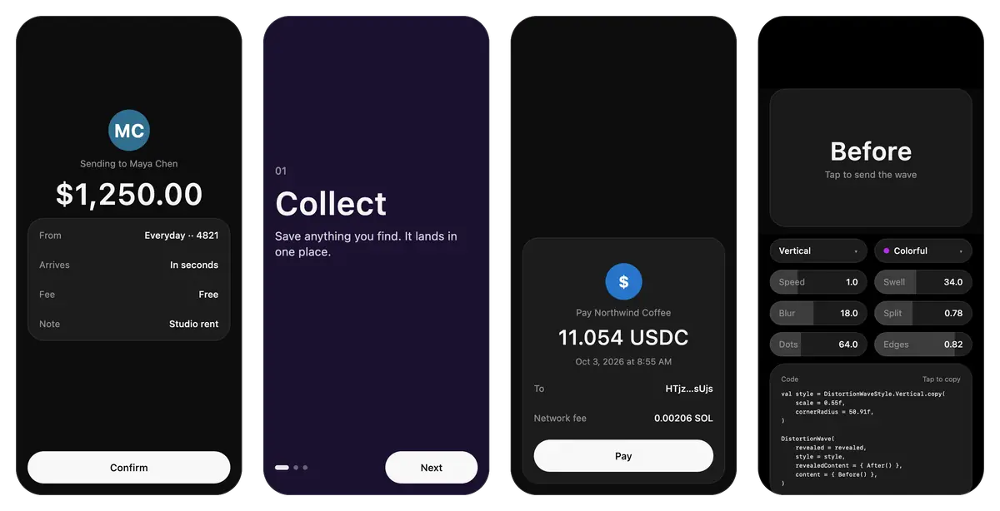

<p align="center"></p>

<h1 align="center">Distortion Waves</h1>

<p align=center>
    <a href="https://search.maven.org/artifact/at.florianschuster.distortionwaves/distortion-waves"></a>
    <a href="LICENSE"></a>
</p>

<p align=center>
    <a href="https://github.com/floschu/distortion-waves/"></a>
    <a href="https://github.com/floschu/distortion-waves/actions"></a>
</p>

> [!NOTE]
> A Compose Multiplatform port of [Distortion Waves](https://libraries.dev/waves) by [Jakub Antalik](https://x.com/jakubantalik):
>
> *A colourful wave that carries one screen into the next. The screen pulls toward the button first, then the wave leaves from where it was touched, leaning that way, and leaves its colour on the edges. Vertical, horizontal and center. React and SwiftUI.*

<p align="center"></p>

## installation

``` kotlin
repositories {
    mavenCentral()
}

dependencies {
    implementation("at.florianschuster.distortionwaves:distortion-waves:$version")
}
```

Runs on Android, iOS, desktop and Wasm. On Android the wave needs Android 13. Below that, and when the system asks for less motion, it is a crossfade.

## usage

``` kotlin
var sent by remember { mutableStateOf(false) }

DistortionWave(
    revealed = sent,
    modifier = Modifier.fillMaxSize(),
    overlay = {
        Button(
            onClick = { sent = !sent },
            modifier = Modifier
                .align(alignment = Alignment.BottomCenter)
                .distortionWaveSource(),
        ) {
            Text(text = if (sent) "Done" else "Confirm")
        }
    },
    revealedContent = { Receipt() },
    content = { Review() },
)
```

## skills

Check out the [distortion-waves skill](skills/distortion-waves) to implement `distortion-waves` with your **AI agents**. It also documents `DistortionWaveContent`, `DistortionWaveState`, styling and platform support.

## author

visit my [website](https://flosch.at/).
